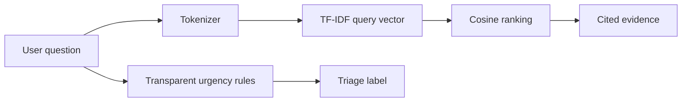

# NyayaLens AI

[](https://github.com/Rajesh-444/nyayalens-ai/actions/workflows/ci.yml)


An explainable legal-document retrieval prototype that returns the most relevant passages, a transparent urgency signal, and citations for every result. It is intentionally local and deterministic, so reviewers can run and inspect the complete NLP pipeline without an API key.

> Educational portfolio project only. The included corpus is synthetic and the output is not legal advice.

## Why this project

Many chatbot demos hide retrieval quality behind an LLM. NyayaLens makes the evidence layer visible: tokenization, inverse-document-frequency weighting, cosine similarity, and rule-based urgency signals are all small, tested Python components.

## Architecture



## Try it

```bash
python -m nyayalens.cli "My employer has not paid my final salary"
```

From a fresh clone:

```bash
PYTHONPATH=src python -m nyayalens.cli "My employer has not paid my final salary"
PYTHONPATH=src python -m unittest discover -s tests -v
```

## Implementation highlights

- A reusable `TfidfRetriever` with no hidden services or network calls
- Ranked evidence with stable document IDs and relevance scores
- An explainable `UrgencyTriage` component instead of an opaque label
- Unit tests for ranking, empty queries, citations, and triage behavior
- A JSONL corpus format that can be replaced with verified source material

## AI safety and guardrails

| Control | Behavior |
| --- | --- |
| Prompt-injection filter | Blocks common attempts to override instructions or expose hidden prompts before retrieval |
| Data minimization | Redacts email addresses, Indian phone numbers, and 12-digit identity-like values |
| Input bounds | Rejects empty inputs and queries longer than 1,000 characters |
| Explainability | Shows the matched urgency signals and cites every retrieved document |
| High-stakes boundary | Uses a synthetic corpus, labels output as educational, and never presents a legal conclusion |

Guardrails are deterministic and unit tested. They reduce obvious misuse, but they are not a substitute for authenticated sources, legal review, adversarial evaluation, or human escalation in a production system.

## Production roadmap

- Hybrid BM25 + embedding search with a reranker
- Human-reviewed evaluation set with Recall@k and nDCG
- Versioned source ingestion and citation-level audit logs
- Guardrailed LLM synthesis that is allowed to answer only from retrieved evidence

